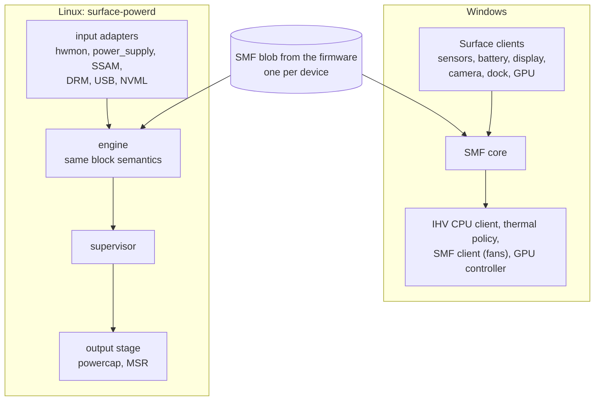
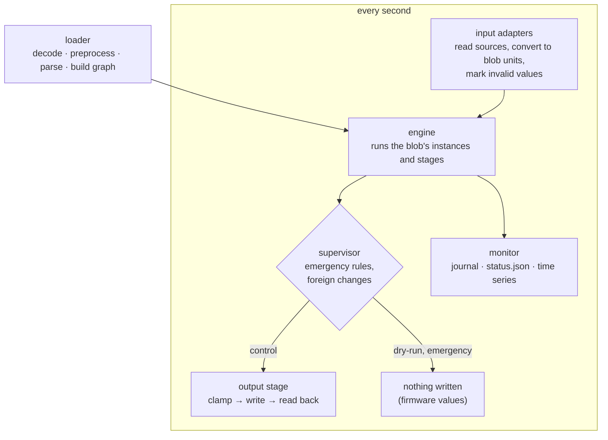
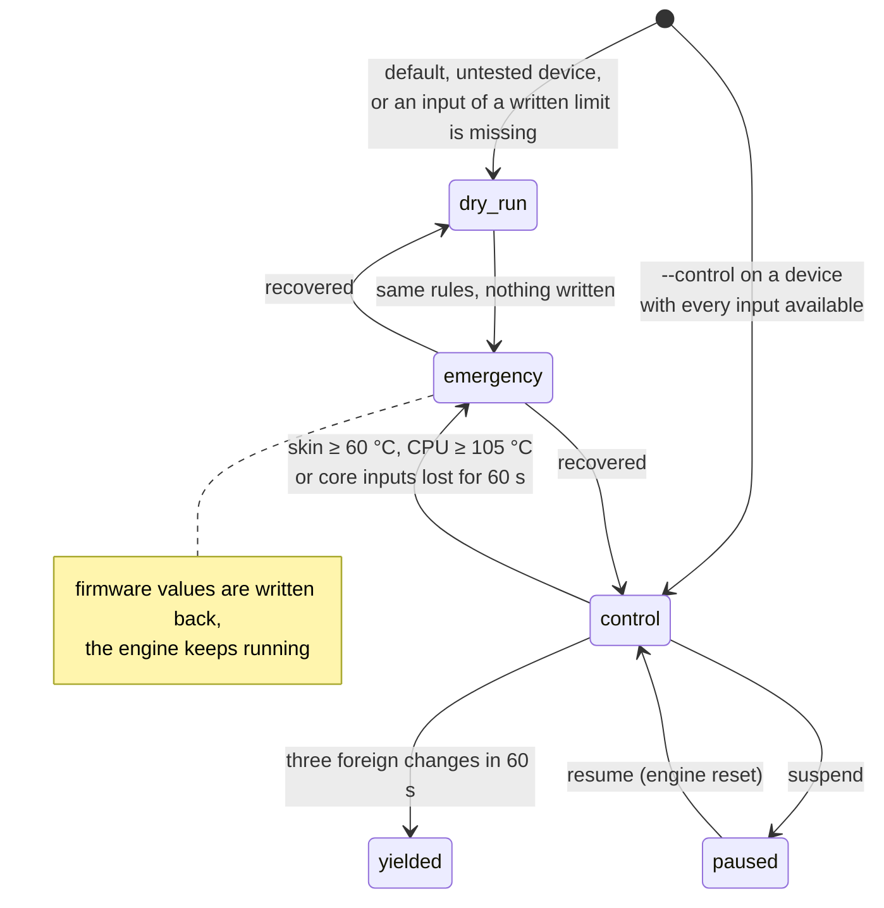
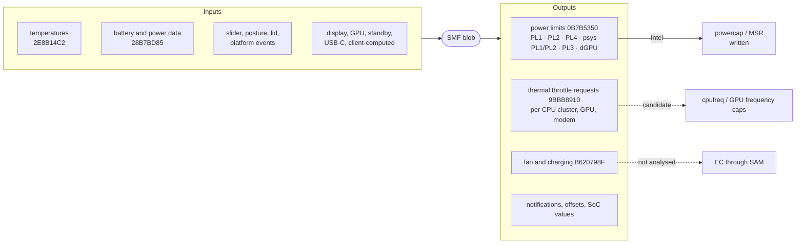

# Documentation

How linux-surface-power works, and where to find what. The details are in the sub-folders; this page is the map.

## The idea in one picture

On Windows, the Surface System Management Framework (SMF) evaluates a configuration blob that the firmware ships. Small client drivers
feed it with sensor values and carry its results to the hardware. On Linux, one daemon takes the place of the core and the clients: it
reads the same blob, collects the same inputs from Linux interfaces, evaluates the blob the way the Windows core does, and writes the
results where Linux can.

## What the daemon does every cycle

## States of the daemon

## Where each value comes from and goes

The blob reads *input channels* and writes *output channels*, both named `interface GUID / channel`. Every device page lists them.

- **Intel devices:** the power limits are written through powercap (PL1, PL2, psys) and optionally PL4 and PL3.
- **AMD and Snapdragon devices:** Linux has no write path for the power limits yet. On the Snapdragon models the blob regulates mainly
  through thermal throttle requests, for which cpufreq caps are the Linux candidate.
- Everything without a Linux path is computed and logged, so the values can be compared with Windows.

## Map

| Folder | What is in it |
|---|---|
| [`devices/`](devices/README.md) | one page per Surface: blob, inputs, outputs, block types, where Linux gets or puts each value (generated) |
| [`research/`](research/README.md) | findings: SB3 root cause, Windows measurements, SMF architecture, device survey, Linux interfaces, field tests, newer blobs |
| [`requirements/`](requirements/README.md) | requirements, acceptance criteria, architecture, ideas |
| [`specs/`](specs/README.md) | technical specifications the code implements: blob format, engine, controller, inputs, outputs, supervisor, monitoring, tools, deviations |

Evidence markers used throughout: [C] from the Windows driver code, [M] measured, [H] hypothesis, [D] our design decision.
