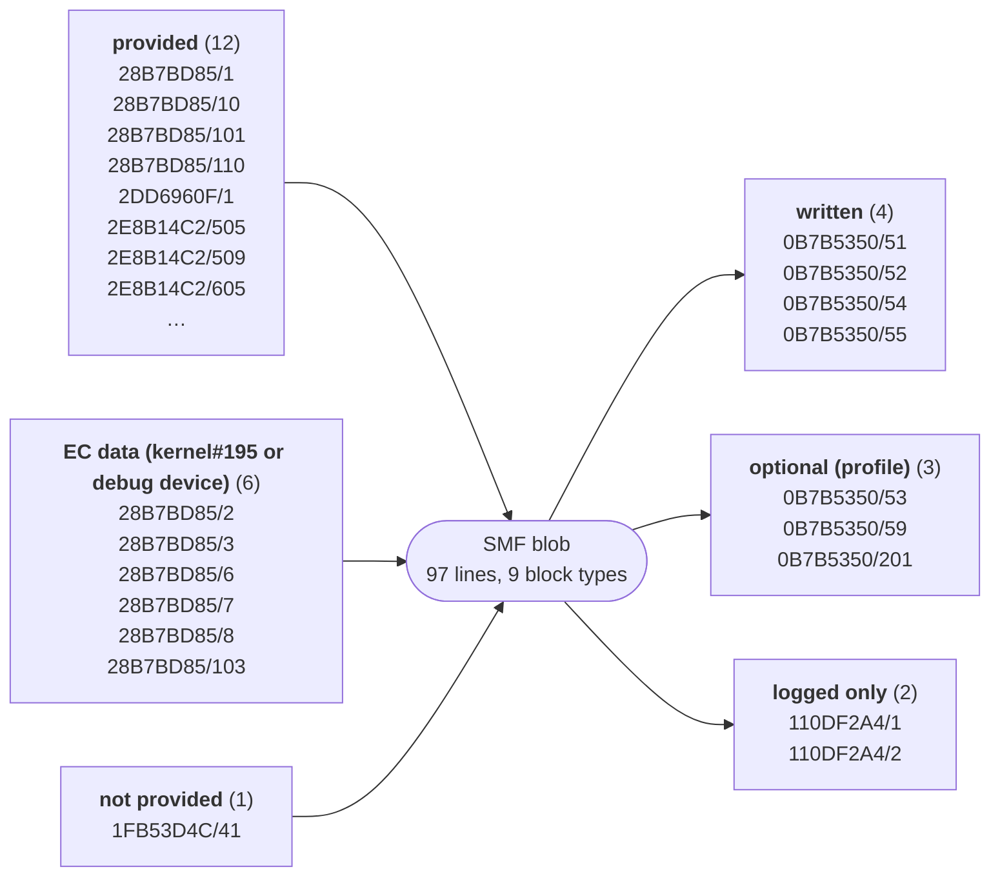

# Surface Book 3 13.5"

Generated by `scripts/device-docs.py` from the local blob corpus, as of 16.11.2026. Status of the Linux side: [`../specs/inputs.md`](../specs/inputs.md), [`../specs/outputs.md`](../specs/outputs.md). Nothing on this page is verified on the device unless it says so.

## Blob

| File | Form | Lines | SHA-256 (text, first 16) | Engine runs it |
|---|---|---|---|---|
| Smf_13in_39.0.1.7.bin | capsule/B | 97 | `85b243ac01e82bed` | ✓ |

- **Platform:** Intel
- **Controller variant:** `classic` (profile `surface-book-3.toml`)
- **Block types:** add_sub_scale (8), linear_map (5), lookup_table (13), min_max (5), multiplexer (5), pass_through (6), pid_sets (4), weighted_mean (1), window_comparator (8)

## Overview

## Inputs

| Channel | Microsoft name | Meaning | Linux source | Status | Reaches limits |
|---|---|---|---|---|---|
| `1FB53D4C/41` | – | display brightness, millinits | – (Windows fallback, DV-3) | not provided | PL4 |
| `28B7BD85/1` | I_BATT1_RSOC | charge level of battery 1, % | `BAT1/capacity` | provided | PL1, psys PL1, psys PL2, dGPU |
| `28B7BD85/2` | I_BAT_PEAK1 | battery peak power, mW | EC `0x53` | EC data (kernel#195 or debug device) | PL4 |
| `28B7BD85/3` | I_BAT_MAX1 | battery sustained power, mW | EC `0x53` | EC data (kernel#195 or debug device) | PL3 |
| `28B7BD85/6` | I_ROP_DYN | rest-of-platform power, mW | EC `0x53` | EC data (kernel#195 or debug device) | PL4 |
| `28B7BD85/7` | I_PSU_SIZE | power supply rating, mW | EC `ARTG` | EC data (kernel#195 or debug device) | psys PL1, dGPU |
| `28B7BD85/8` | I_IPL_TOP | available input power, mW | EC `0x53` | EC data (kernel#195 or debug device) | PL4, psys PL1, psys PL2, PL3, dGPU |
| `28B7BD85/10` | – | charge/discharge rate of battery 1, mW | `BAT1/power_now` | provided | PL1 |
| `28B7BD85/101` | – | charge level of battery 2 (base), % | `BAT2/capacity` | provided | psys PL1, dGPU |
| `28B7BD85/103` | – | battery 2 sustained power, mW | EC `0x53` (base) | EC data (kernel#195 or debug device) | dGPU |
| `28B7BD85/110` | – | charge/discharge rate of battery 2, mW | `BAT2/power_now` | provided | dGPU |
| `2DD6960F/1` | I_SLIDER | power slider 1–10 | `platform_profile` × AC | provided | PL1, PL2, dGPU |
| `2E8B14C2/505` | – | SAM sensor 5 | hwmon `surface_thermal` temp5 | provided | – |
| `2E8B14C2/509` | – | SAM sensor 9 | hwmon `surface_thermal` temp9 | provided | PL1 |
| `2E8B14C2/605` | – | KIP (base) sensor 5 | hwmon `surface_thermal` (base) temp5 | provided | – |
| `2E8B14C2/609` | – | KIP (base) sensor 9 | hwmon `surface_thermal` (base) temp9 | provided | dGPU |
| `8060B17F/1` | I_POSTURE | posture 1–5 | `surface_dtx` + lid | provided | PL1, dGPU |
| `8060B17F/2` | I_EXT_DISPLAY | external display connected | DRM connectors | provided | PL1 |
| `8060B17F/3` | I_CAMERA | camera in use | video4linux runtime PM / open nodes | provided | PL1 |

## Outputs

| Channel | Microsoft name | Meaning | Linux | Status | Range (default / max / min) |
|---|---|---|---|---|---|
| `0B7B5350/51` | O_CPU_AVG | PL1, package long-term | powercap `package-0/long_term` | written | 25000 / 31000 / 7500 |
| `0B7B5350/52` | O_CPU_MAX | PL2, package short-term | powercap `package-0/short_term` | written | 46000 / 62000 / 15000 |
| `0B7B5350/53` | O_CPU_PEAK | PL4, package peak | powercap `package-0/peak_power` | optional (profile) | 101000 / 130000 / 15000 |
| `0B7B5350/54` | O_SYS_AVG | psys PL1, platform long-term | powercap `psys/long_term` | written | 45000 / 101000 / 10000 |
| `0B7B5350/55` | O_SYS_MAX | psys PL2, platform short-term | powercap `psys/short_term` | written | 45000 / 101000 / 10000 |
| `0B7B5350/59` | O_SYS_PEAK | PL3, platform peak with duty cycle | MSR `0x615` | optional (profile) | 65000 / 101000 / 20000 |
| `0B7B5350/201` | – | dGPU power limit | clock-cap stand-in (DO-1, profile) | optional (profile) | 35000 / 41000 / 10000 |
| `110DF2A4/1` | O_HOT | hot notification | – | logged only | – |
| `110DF2A4/2` | O_CRT | critical notification | – | logged only | – |
