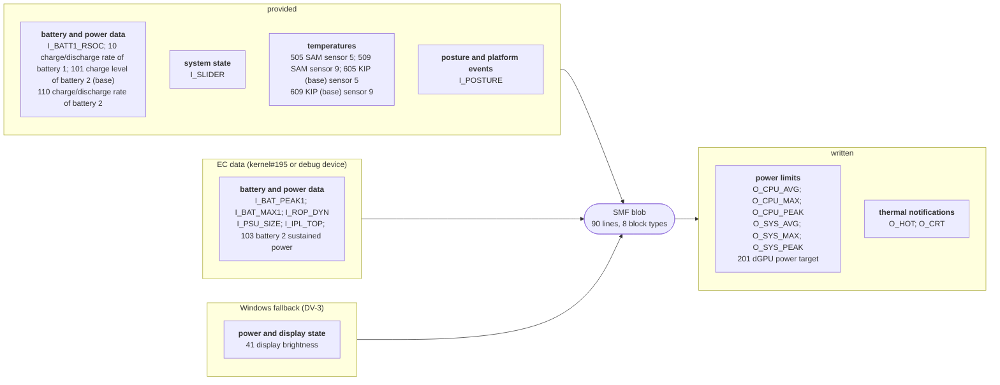

# Surface Book 3 15"

Generated by `scripts/device-docs.py` from the local blob corpus, as of 17.11.2026. Status of the Linux side: [`../specs/inputs.md`](../specs/inputs.md), [`../specs/outputs.md`](../specs/outputs.md). Nothing on this page is verified on the device unless it says so.

## Blob

| File | Form | Lines | SHA-256 (text, first 16) | Engine runs it |
|---|---|---|---|---|
| Smf_15in_39.0.1.4.bin | capsule/B | 90 | `b75ee1a399c02c7c` | ✓ |

- **Platform:** Intel
- **Controller variant:** `classic` (profile `surface-book-3.toml`)
- **Block types:** add_sub_scale (7), linear_map (5), lookup_table (10), min_max (5), multiplexer (4), pass_through (5), pid_sets (4), window_comparator (8)

## Overview

Every input and output of the blob(s), grouped by what Linux does with it.

## Readiness

A device can be controlled only when every output of its blob is written: a blob that regulates the CPU but whose fan, throttle or safety outputs go nowhere would run with part of its design missing.

| Check | Result |
|---|---|
| Blob runs | ✓ |
| Inputs with a Linux source | 17 of 17 |
| Outputs written by Linux | 9 of 9 |
| Ready for control | yes |

## Inputs

| Channel | Microsoft name | Meaning | Linux source | Status | Reaches limits |
|---|---|---|---|---|---|
| `1FB53D4C/41` | – | display brightness, millinits | none: the block default, as on Windows without it (DV-3) | Windows fallback (DV-3) | PL4 |
| `28B7BD85/1` | I_BATT1_RSOC | charge level of battery 1, % | `BAT1/capacity` | provided | PL1, psys PL1, psys PL2 |
| `28B7BD85/2` | I_BAT_PEAK1 | battery peak power, mW | EC `0x53` | EC data (kernel#195 or debug device) | PL4 |
| `28B7BD85/3` | I_BAT_MAX1 | battery sustained power, mW | EC `0x53` | EC data (kernel#195 or debug device) | PL3 |
| `28B7BD85/6` | I_ROP_DYN | rest-of-platform power, mW | EC `0x53` | EC data (kernel#195 or debug device) | PL4 |
| `28B7BD85/7` | I_PSU_SIZE | power supply rating, mW | EC `ARTG` | EC data (kernel#195 or debug device) | psys PL1, dGPU |
| `28B7BD85/8` | I_IPL_TOP | available input power, mW | EC `0x53` | EC data (kernel#195 or debug device) | PL4, psys PL1, psys PL2, PL3, dGPU |
| `28B7BD85/10` | – | charge/discharge rate of battery 1, mW | `BAT1/power_now` | provided | PL1 |
| `28B7BD85/101` | – | charge level of battery 2 (base), % | `BAT2/capacity` | provided | dGPU |
| `28B7BD85/103` | – | battery 2 sustained power, mW | EC `0x53` (base) | EC data (kernel#195 or debug device) | dGPU |
| `28B7BD85/110` | – | charge/discharge rate of battery 2, mW | `BAT2/power_now` | provided | dGPU |
| `2DD6960F/1` | I_SLIDER | power slider 1–10 | `platform_profile` × AC | provided | PL1, PL2, dGPU |
| `2E8B14C2/505` | – | SAM sensor 5 | hwmon `surface_thermal` temp5 | provided | – |
| `2E8B14C2/509` | – | SAM sensor 9 | hwmon `surface_thermal` temp9 | provided | PL1 |
| `2E8B14C2/605` | – | KIP (base) sensor 5 | hwmon `surface_thermal` (base) temp5 | provided | – |
| `2E8B14C2/609` | – | KIP (base) sensor 9 | hwmon `surface_thermal` (base) temp9 | provided | dGPU |
| `8060B17F/1` | I_POSTURE | posture 1–5 | `surface_dtx` + lid | provided | PL1, dGPU |

## Outputs

| Channel | Microsoft name | Meaning | Linux | Status | Range (default / max / min) |
|---|---|---|---|---|---|
| `0B7B5350/51` | O_CPU_AVG | PL1, package long-term | powercap `package-0/long_term` | written | 25000 / 31000 / 7500 |
| `0B7B5350/52` | O_CPU_MAX | PL2, package short-term | powercap `package-0/short_term` | written | 46000 / 62000 / 15000 |
| `0B7B5350/53` | O_CPU_PEAK | PL4, package peak | powercap `package-0/peak_power` (automatic, held without EC data) | written | 101000 / 130000 / 15000 |
| `0B7B5350/54` | O_SYS_AVG | psys PL1, platform long-term | powercap `psys/long_term` | written | – |
| `0B7B5350/55` | O_SYS_MAX | psys PL2, platform short-term | powercap `psys/short_term` | written | – |
| `0B7B5350/59` | O_SYS_PEAK | PL3, platform peak with duty cycle | MSR `0x615` (root; profile opt-in where Windows' write is verified; held without EC data) | written | – |
| `0B7B5350/201` | – | dGPU power target (SB3: power limit; Laptop Studio: on/off request) | clock-cap stand-in (profile option, off by default; observe-only option) | written | 65000 / 71000 / 15000 |
| `110DF2A4/1` | O_HOT | hibernate request at 2 (thermal policy of zone `TPOL`) | thermal action: hibernate, else suspend | written | – |
| `110DF2A4/2` | O_CRT | critical shutdown request at 2 (thermal policy of zone `TPOL`) | thermal action: power off | written | – |
