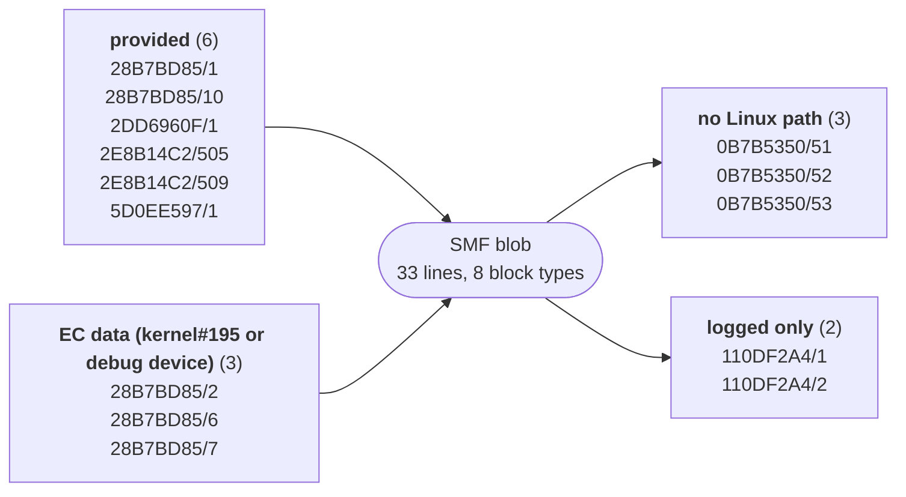

# Surface Laptop 3 (AMD)

Generated by `scripts/device-docs.py` from the local blob corpus, as of 16.11.2026. Status of the Linux side: [`../specs/inputs.md`](../specs/inputs.md), [`../specs/outputs.md`](../specs/outputs.md). Nothing on this page is verified on the device unless it says so.

## Blob

| File | Form | Lines | SHA-256 (text, first 16) | Engine runs it |
|---|---|---|---|---|
| Smf_0.0.0.18.bin | capsule/A | 33 | `b0140ba1c29e994f` | ✓ |

- **Platform:** AMD
- **Controller variant:** `classic` (profile `surface-laptop-3-amd.toml`)
- **Block types:** add_sub_scale (1), linear_map (2), lookup_table (5), min_max (3), multiplexer (1), pass_through (2), pid_sets (2), window_comparator (4)

## Overview

## Inputs

| Channel | Microsoft name | Meaning | Linux source | Status | Reaches limits |
|---|---|---|---|---|---|
| `28B7BD85/1` | I_BATT1_RSOC | charge level of battery 1, % | `BAT1/capacity` | provided | PL1 |
| `28B7BD85/2` | I_BAT_PEAK1 | battery peak power, mW | EC `0x53` | EC data (kernel#195 or debug device) | PL4 |
| `28B7BD85/6` | I_ROP_DYN | rest-of-platform power, mW | EC `0x53` | EC data (kernel#195 or debug device) | PL4 |
| `28B7BD85/7` | I_PSU_SIZE | power supply rating, mW | EC `ARTG` | EC data (kernel#195 or debug device) | PL1, PL4 |
| `28B7BD85/10` | – | charge/discharge rate of battery 1, mW | `BAT1/power_now` | provided | PL1 |
| `2DD6960F/1` | I_SLIDER | power slider 1–10 | `platform_profile` × AC | provided | PL1, PL2 |
| `2E8B14C2/505` | – | SAM sensor 5 | hwmon `surface_thermal` temp5 | provided | – |
| `2E8B14C2/509` | – | SAM sensor 9 | hwmon `surface_thermal` temp9 | provided | PL1 |
| `5D0EE597/1` | I_LID | lid open/closed | lid switch | provided | PL1 |

## Outputs

| Channel | Microsoft name | Meaning | Linux | Status | Range (default / max / min) |
|---|---|---|---|---|---|
| `0B7B5350/51` | O_CPU_AVG | PL1, package long-term | none on AMD (Intel RAPL only) | no Linux path | 15000 / 30000 / 4000 |
| `0B7B5350/52` | O_CPU_MAX | PL2, package short-term | none on AMD (Intel RAPL only) | no Linux path | 30000 / 35000 / 4000 |
| `0B7B5350/53` | O_CPU_PEAK | PL4, package peak | none on AMD (Intel RAPL only) | no Linux path | 70000 / 70000 / 5000 |
| `110DF2A4/1` | O_HOT | hot notification | – | logged only | – |
| `110DF2A4/2` | O_CRT | critical notification | – | logged only | – |
