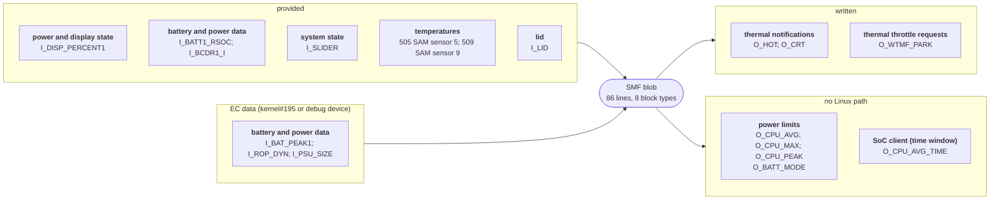

# Surface Laptop 4 (AMD)

Generated by `scripts/device-docs.py` from the local blob corpus, as of 23.11.2026. Status of the Linux side: [`../specs/inputs.md`](../specs/inputs.md), [`../specs/outputs.md`](../specs/outputs.md). Nothing on this page is verified on the device unless it says so.

## Blob

| File | Form | Lines | SHA-256 (text, first 16) | Engine runs it |
|---|---|---|---|---|
| Smf_0.0.0.88.bin | capsule/B | 43 | `f987d463c9b33f9e` | ✓ |
| Smf_13in_0.0.0.86.bin | capsule/B | 43 | `1f00423b85898fef` | ✓ |

- **Platform:** AMD
- **Controller variant:** `classic` (profile `surface-laptop-4-amd.toml`)
- **Block types:** add_sub_scale (2), linear_map (6), lookup_table (18), min_max (10), multiplexer (2), pass_through (8), pid_sets (4), window_comparator (10)

## Overview

Every input and output of the blob(s), grouped by what Linux does with it.

## Readiness

A device can be controlled only when every output of its blob is written: a blob that regulates the CPU but whose fan, throttle or safety outputs go nowhere would run with part of its design missing.

| Check | Result |
|---|---|
| Blob runs | ✓ |
| Inputs with a Linux source | 10 of 10 |
| Outputs written by Linux | 3 of 8 (not written: `0B7B5350/51`, `0B7B5350/52`, `0B7B5350/53`, `0B7B5350/70`, `CF2F6076/61`) |
| Ready for control | no: dry-run only |

## Inputs

| Channel | Microsoft name | Meaning | Linux source | Status | Reaches limits |
|---|---|---|---|---|---|
| `1FB53D4C/42` | I_DISP_PERCENT1 | display brightness, % | backlight | provided | PL4 |
| `28B7BD85/1` | I_BATT1_RSOC | charge level of battery 1, % | `BAT1/capacity` | provided | PL1 |
| `28B7BD85/2` | I_BAT_PEAK1 | battery peak power, mW | EC `0x53` | EC data (kernel#195 or debug device) | PL4 |
| `28B7BD85/6` | I_ROP_DYN | rest-of-platform power, mW | EC `0x53` | EC data (kernel#195 or debug device) | PL4 |
| `28B7BD85/7` | I_PSU_SIZE | power supply rating, mW | EC `ARTG` | EC data (kernel#195 or debug device) | PL1, PL4 |
| `28B7BD85/12` | I_BCDR1_I | battery current, mA (+ discharging) | `BAT1` current or power/voltage | provided | PL1 |
| `2DD6960F/1` | I_SLIDER | power slider 1–10 | `platform_profile` × AC | provided | PL1, PL2 |
| `2E8B14C2/505` | – | SAM sensor 5 | hwmon `surface_thermal` temp5 | provided | – |
| `2E8B14C2/509` | – | SAM sensor 9 | hwmon `surface_thermal` temp9 | provided | PL1 |
| `5D0EE597/1` | I_LID | lid open/closed | lid switch | provided | PL1 |

## Outputs

| Channel | Microsoft name | Meaning | Linux | Status | Range (default / max / min) |
|---|---|---|---|---|---|
| `0B7B5350/51` | O_CPU_AVG | PL1, package long-term | none on AMD (Intel RAPL only) | no Linux path | 15000 / 31000 / 4000 |
| `0B7B5350/52` | O_CPU_MAX | PL2, package short-term | none on AMD (Intel RAPL only) | no Linux path | 30000 / 61000 / 4000 |
| `0B7B5350/53` | O_CPU_PEAK | PL4, package peak | none on AMD (Intel RAPL only) | no Linux path | 70000 / 70000 / 5000 |
| `0B7B5350/70` | O_BATT_MODE | battery mode (1 = adapter rating 0, i.e. on battery) | none on AMD (only the Intel SoC client is analysed) | no Linux path | – |
| `110DF2A4/1` | O_HOT | hibernate request at 2 (thermal policy of zone `TPOL`) | thermal action: hibernate, else suspend | written | – |
| `110DF2A4/2` | O_CRT | critical shutdown request at 2 (thermal policy of zone `TPOL`) | thermal action: power off | written | – |
| `9BBB8910/62` | O_WTMF_PARK | passive limit of zone `TPOL`, % (processor aggregator device) | cpufreq cap on all CPU policies (minimum with the other requests) | written | – |
| `CF2F6076/61` | O_CPU_AVG_TIME | PL1 time window, ms (rounded up to 4 steps per octave) | none on AMD (Intel RAPL only) | no Linux path | – |
