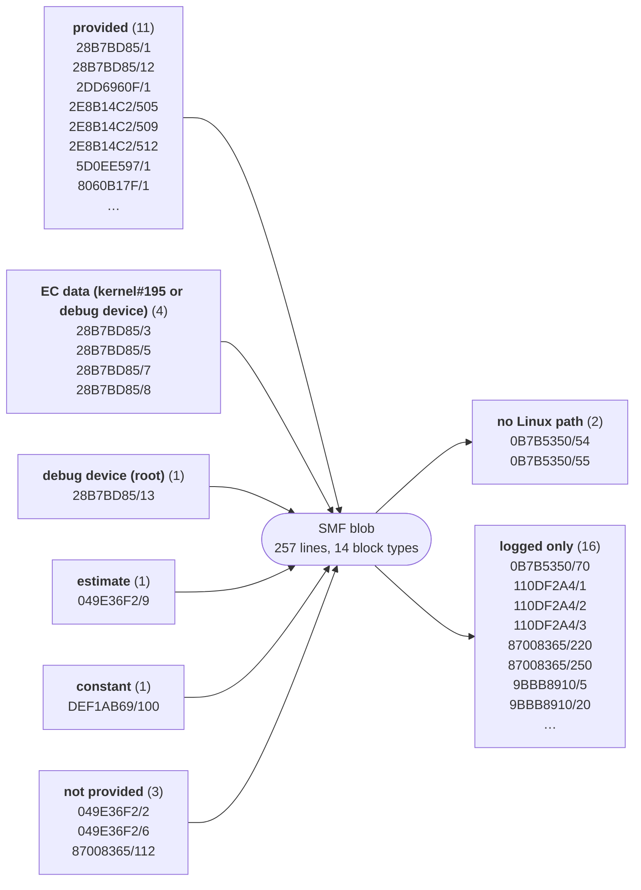

# Surface Laptop 7 (Snapdragon, arm64)

Generated by `scripts/device-docs.py` from the local blob corpus, as of 16.11.2026. Status of the Linux side: [`../specs/inputs.md`](../specs/inputs.md), [`../specs/outputs.md`](../specs/outputs.md). Nothing on this page is verified on the device unless it says so.

## Blob

| File | Form | Lines | SHA-256 (text, first 16) | Engine runs it |
|---|---|---|---|---|
| Surface.SMF.108.0.13_108.0.13.92.bin | capsule/B | 128 | `e0f00f0f6f02770d` | ✓ |
| Surface.SMF.108.0.15_108.0.15.93.bin | capsule/B | 129 | `4ea217bc626a064a` | ✓ |

- **Platform:** Qualcomm Snapdragon (arm64)
- **Controller variant:** `direct` (no profile: default)
- **Block types:** add_sub_scale (16), conditional_table (6), ewma (10), hysteresis_quantiser (4), hysteresis_table (6), linear_map (6), lookup_table (54), min_max (38), multiplexer (4), multiply_divide (10), pass_through (34), pid_sets (8), variable_pid (4), window_comparator (10)

## Overview

## Inputs

| Channel | Microsoft name | Meaning | Linux source | Status | Reaches limits |
|---|---|---|---|---|---|
| `049E36F2/2` | I_SYS_PWR | system power from the power meters, mW | – | not provided | – |
| `049E36F2/6` | – | power-meter item (not analysed) | – | not provided | – |
| `049E36F2/9` | I_USB_SOURCE_PWR | power out of the USB-C ports, mW | Type-C ports (upper bound) | estimate | psys PL2 |
| `28B7BD85/1` | I_BATT1_RSOC | charge level of battery 1, % | `BAT1/capacity` | provided | – |
| `28B7BD85/3` | I_BAT_MAX1 | battery sustained power, mW | EC `0x53` | EC data (kernel#195 or debug device) | – |
| `28B7BD85/5` | I_BAT_VNL1 | battery open-circuit voltage, mV | EC `0x53` | EC data (kernel#195 or debug device) | psys PL2 |
| `28B7BD85/7` | I_PSU_SIZE | power supply rating, mW | EC `ARTG` | EC data (kernel#195 or debug device) | – |
| `28B7BD85/8` | I_IPL_TOP | available input power, mW | EC `0x53` | EC data (kernel#195 or debug device) | psys PL2 |
| `28B7BD85/12` | I_BCDR1_I | battery current, mA (+ discharging) | `BAT1` current or power/voltage | provided | – |
| `28B7BD85/13` | I_BDR_EWMA1_LVL | discharge-rate EWMA level | EC `0x1A` | debug device (root) | – |
| `2DD6960F/1` | I_SLIDER | power slider 1–10 | `platform_profile` × AC | provided | psys PL2 |
| `2E8B14C2/505` | – | SAM sensor 5 | hwmon `surface_thermal` temp5 | provided | – |
| `2E8B14C2/509` | – | SAM sensor 9 | hwmon `surface_thermal` temp9 | provided | – |
| `2E8B14C2/512` | – | SAM sensor 12 | hwmon `surface_thermal` temp12 | provided | – |
| `5D0EE597/1` | I_LID | lid open/closed | lid switch | provided | – |
| `8060B17F/1` | I_POSTURE | posture 1–5 | `surface_dtx` + lid | provided | – |
| `8060B17F/2` | I_EXT_DISPLAY | external display connected | DRM connectors | provided | – |
| `8060B17F/3` | I_CAMERA | camera in use | video4linux runtime PM / open nodes | provided | – |
| `8060B17F/9` | I_SURF_DOCK | Surface Docks attached | USB IDs | provided | – |
| `87008365/112` | I_CPU_TEMP_AVG | averaged CPU temperature (client-computed) | – | not provided | – |
| `DEF1AB69/100` | I_MS_NOTIFY | Modern Standby phase 1–5 | constant 4 | constant | – |

## Outputs

| Channel | Microsoft name | Meaning | Linux | Status | Range (default / max / min) |
|---|---|---|---|---|---|
| `0B7B5350/54` | O_SYS_AVG | psys PL1, platform long-term | none on Qualcomm Snapdragon (arm64) (Intel RAPL only) | no Linux path | 45000 / 250000 / 15000 |
| `0B7B5350/55` | O_SYS_MAX | psys PL2, platform short-term | none on Qualcomm Snapdragon (arm64) (Intel RAPL only) | no Linux path | 90000 / 250000 / 15000 |
| `0B7B5350/70` | O_BATT_MODE | battery mode | – | logged only | – |
| `110DF2A4/1` | O_HOT | hot notification | – | logged only | – |
| `110DF2A4/2` | O_CRT | critical notification | – | logged only | – |
| `110DF2A4/3` | O_MINPWR2 | minimum-power request | – | logged only | – |
| `87008365/220` | O_FAST_MAXIM_POLLING | fast power-meter polling | – | logged only | – |
| `87008365/250` | – | not analysed | – | logged only | – |
| `9BBB8910/5` | O_WTMF_GFX | throttle request for the GPU, % (100 = none) | candidate: GPU maximum frequency | logged only | 100 / 100 / 0 |
| `9BBB8910/20` | O_WTMF_E_CORES_C1 | throttle request for a CPU cluster, % (100 = none) | candidate: cpufreq `scaling_max_freq` | logged only | – |
| `9BBB8910/21` | O_WTMF_P_CORES_C2 | throttle request for a CPU cluster, % (100 = none) | candidate: cpufreq `scaling_max_freq` | logged only | – |
| `9BBB8910/22` | O_WTMF_P_CORES_C3 | throttle request for a CPU cluster, % (100 = none) | candidate: cpufreq `scaling_max_freq` | logged only | – |
| `9BBB8910/62` | O_WTMF_PARK | core parking request | candidate: take CPUs offline | logged only | – |
| `9BBB8910/200` | O_WTMF_NPU | throttle request, % (100 = none) | – | logged only | – |
| `B620798F/101` | – | fan or charging setting for the EC | candidate: EC through SAM (commands not known) | logged only | – |
| `B620798F/111` | – | fan or charging setting for the EC | candidate: EC through SAM (commands not known) | logged only | – |
| `B620798F/201` | O_FAN1_PROFILE | fan or charging setting for the EC | candidate: EC through SAM (commands not known) | logged only | – |
| `B620798F/301` | O_FAN_CS_REQUEST | fan or charging setting for the EC | candidate: EC through SAM (commands not known) | logged only | – |
