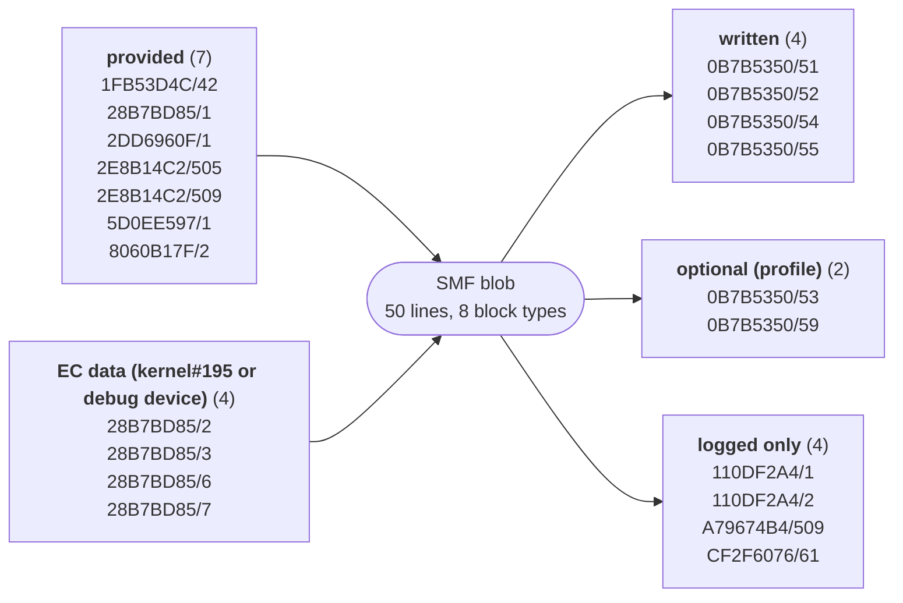

# Surface Laptop Go

Generated by `scripts/device-docs.py` from the local blob corpus, as of 16.11.2026. Status of the Linux side: [`../specs/inputs.md`](../specs/inputs.md), [`../specs/outputs.md`](../specs/outputs.md). Nothing on this page is verified on the device unless it says so.

## Blob

| File | Form | Lines | SHA-256 (text, first 16) | Engine runs it |
|---|---|---|---|---|
| Smf_57.0.1.43.bin | capsule/B | 50 | `8315edd28f916d74` | ✓ |

- **Platform:** Intel
- **Controller variant:** `classic` (profile `surface-laptop-go.toml`)
- **Block types:** add_sub_scale (6), linear_map (3), lookup_table (10), min_max (6), multiplexer (3), pass_through (5), pid_sets (1), window_comparator (5)

## Overview

## Inputs

| Channel | Microsoft name | Meaning | Linux source | Status | Reaches limits |
|---|---|---|---|---|---|
| `1FB53D4C/42` | I_DISP_PERCENT1 | display brightness, % | backlight | provided | PL4 |
| `28B7BD85/1` | I_BATT1_RSOC | charge level of battery 1, % | `BAT1/capacity` | provided | psys PL1, psys PL2 |
| `28B7BD85/2` | I_BAT_PEAK1 | battery peak power, mW | EC `0x53` | EC data (kernel#195 or debug device) | PL4 |
| `28B7BD85/3` | I_BAT_MAX1 | battery sustained power, mW | EC `0x53` | EC data (kernel#195 or debug device) | PL3 |
| `28B7BD85/6` | I_ROP_DYN | rest-of-platform power, mW | EC `0x53` | EC data (kernel#195 or debug device) | PL4 |
| `28B7BD85/7` | I_PSU_SIZE | power supply rating, mW | EC `ARTG` | EC data (kernel#195 or debug device) | PL4, psys PL1, psys PL2, PL3 |
| `2DD6960F/1` | I_SLIDER | power slider 1–10 | `platform_profile` × AC | provided | PL1, PL2 |
| `2E8B14C2/505` | – | SAM sensor 5 | hwmon `surface_thermal` temp5 | provided | – |
| `2E8B14C2/509` | – | SAM sensor 9 | hwmon `surface_thermal` temp9 | provided | PL1, PL2 |
| `5D0EE597/1` | I_LID | lid open/closed | lid switch | provided | PL1 |
| `8060B17F/2` | I_EXT_DISPLAY | external display connected | DRM connectors | provided | – |

## Outputs

| Channel | Microsoft name | Meaning | Linux | Status | Range (default / max / min) |
|---|---|---|---|---|---|
| `0B7B5350/51` | O_CPU_AVG | PL1, package long-term | powercap `package-0/long_term` | written | 10000 / 31000 / 7500 |
| `0B7B5350/52` | O_CPU_MAX | PL2, package short-term | powercap `package-0/short_term` | written | 46000 / 62000 / 15000 |
| `0B7B5350/53` | O_CPU_PEAK | PL4, package peak | powercap `package-0/peak_power` | optional (profile) | 101000 / 130000 / 15000 |
| `0B7B5350/54` | O_SYS_AVG | psys PL1, platform long-term | powercap `psys/long_term` | written | 45000 / 101000 / 10000 |
| `0B7B5350/55` | O_SYS_MAX | psys PL2, platform short-term | powercap `psys/short_term` | written | 45000 / 101000 / 10000 |
| `0B7B5350/59` | O_SYS_PEAK | PL3, platform peak with duty cycle | MSR `0x615` | optional (profile) | 65000 / 101000 / 20000 |
| `110DF2A4/1` | O_HOT | hot notification | – | logged only | – |
| `110DF2A4/2` | O_CRT | critical notification | – | logged only | – |
| `A79674B4/509` | O_SEN9_OFFSET | offset for sensor 9 | – | logged only | – |
| `CF2F6076/61` | – | SoC value (not analysed) | – | logged only | – |
