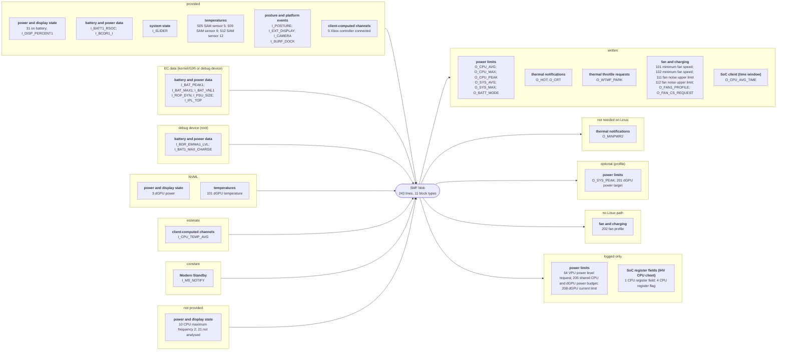

# Surface Laptop Studio 2

Generated by `scripts/device-docs.py` from the local blob corpus, as of 17.11.2026. Status of the Linux side: [`../specs/inputs.md`](../specs/inputs.md), [`../specs/outputs.md`](../specs/outputs.md). Nothing on this page is verified on the device unless it says so.

## Blob

| File | Form | Lines | SHA-256 (text, first 16) | Engine runs it |
|---|---|---|---|---|
| Smf_dGPU_88.0.2.68.bin | capsule/B | 139 | `69eee766112d1b7d` | ✓ |
| Smf_iGPU_88.0.1.41.bin | capsule/B | 104 | `5ecc12f85fd86543` | ✓ |

- **Platform:** Intel
- **Controller variant:** `direct` (profile `surface-laptop-studio-2.toml`)
- **Block types:** add_sub_scale (12), conditional_table (3), hysteresis_quantiser (4), linear_map (15), lookup_table (59), min_max (30), multiplexer (9), multiply_divide (3), pass_through (39), pid_sets (7), window_comparator (10)

## Overview

Every input and output of the blob(s), grouped by what Linux does with it.

## Readiness

A device can be controlled only when every output of its blob is written: a blob that regulates the CPU but whose fan, throttle or safety outputs go nowhere would run with part of its design missing.

| Check | Result |
|---|---|
| Blob runs | ✓ |
| Inputs with a Linux source | 25 of 27 (missing: `1FB53D4C/10`, `1FB53D4C/21`) |
| Outputs written by Linux | 16 of 25; not needed on Linux: `110DF2A4/3` (not written: `0B7B5350/59`, `0B7B5350/64`, `0B7B5350/201`, `0B7B5350/205`, `0B7B5350/208`, `349D0E39/1`, `349D0E39/4`, `B620798F/202`) |
| Ready for control | no: dry-run only |

## Inputs

| Channel | Microsoft name | Meaning | Linux source | Status | Reaches limits |
|---|---|---|---|---|---|
| `1FB53D4C/3` | – | dGPU power, mW | NVML | NVML | PL1 |
| `1FB53D4C/10` | – | CPU maximum frequency 2 | – | not provided | – |
| `1FB53D4C/21` | – | not analysed | – | not provided | – |
| `1FB53D4C/31` | – | on battery, 0/1 | `Mains/online` | provided | PL4 |
| `1FB53D4C/42` | I_DISP_PERCENT1 | display brightness, % | backlight | provided | PL4 |
| `28B7BD85/1` | I_BATT1_RSOC | charge level of battery 1, % | `BAT1/capacity` | provided | psys PL1, psys PL2 |
| `28B7BD85/2` | I_BAT_PEAK1 | battery peak power, mW | EC `0x53` | EC data (kernel#195 or debug device) | PL4 |
| `28B7BD85/3` | I_BAT_MAX1 | battery sustained power, mW | EC `0x53` | EC data (kernel#195 or debug device) | PL1 |
| `28B7BD85/5` | I_BAT_VNL1 | battery open-circuit voltage, mV | EC `0x53` | EC data (kernel#195 or debug device) | – |
| `28B7BD85/6` | I_ROP_DYN | rest-of-platform power, mW | EC `0x53` | EC data (kernel#195 or debug device) | PL4 |
| `28B7BD85/7` | I_PSU_SIZE | power supply rating, mW | EC `ARTG` | EC data (kernel#195 or debug device) | psys PL1 |
| `28B7BD85/8` | I_IPL_TOP | available input power, mW | EC `0x53` | EC data (kernel#195 or debug device) | PL4, psys PL1, psys PL2 |
| `28B7BD85/12` | I_BCDR1_I | battery current, mA (+ discharging) | `BAT1` current or power/voltage | provided | PL1 |
| `28B7BD85/13` | I_BDR_EWMA1_LVL | discharge-rate EWMA level | EC `0x1A` | debug device (root) | PL1 |
| `28B7BD85/16` | I_BAT1_MAX_CHARGE | max charge reached, 0/1 | EC `0x69` | debug device (root) | – |
| `2DD6960F/1` | I_SLIDER | power slider 1–10 | `platform_profile` × AC | provided | PL1, PL2, dGPU |
| `2E8B14C2/101` | – | dGPU temperature | NVML | NVML | – |
| `2E8B14C2/505` | – | SAM sensor 5 | hwmon `surface_thermal` temp5 | provided | – |
| `2E8B14C2/509` | – | SAM sensor 9 | hwmon `surface_thermal` temp9 | provided | PL1 |
| `2E8B14C2/512` | – | SAM sensor 12 | hwmon `surface_thermal` temp12 | provided | PL1 |
| `8060B17F/1` | I_POSTURE | posture 1–5 | `surface_dtx` + lid | provided | PL1, dGPU |
| `8060B17F/2` | I_EXT_DISPLAY | external display connected | DRM connectors | provided | PL1 |
| `8060B17F/3` | I_CAMERA | camera in use | video4linux runtime PM / open nodes | provided | PL1 |
| `8060B17F/9` | I_SURF_DOCK | Surface Docks attached | USB IDs | provided | PL1 |
| `87008365/5` | – | Xbox controller connected | input devices | provided | PL1 |
| `87008365/112` | I_CPU_TEMP_AVG | averaged CPU temperature (client-computed) | `coretemp` package temperature, same single reading as Windows [C] (DV-7) | estimate | – |
| `DEF1AB69/100` | I_MS_NOTIFY | Modern Standby phase 1–5 | constant 4 | constant | PL1, PL2, dGPU |

## Outputs

| Channel | Microsoft name | Meaning | Linux | Status | Range (default / max / min) |
|---|---|---|---|---|---|
| `0B7B5350/51` | O_CPU_AVG | PL1, package long-term | powercap `package-0/long_term` | written | 15000 / 65000 / 3000 |
| `0B7B5350/52` | O_CPU_MAX | PL2, package short-term | powercap `package-0/short_term` | written | 25000 / 100000 / 3000 |
| `0B7B5350/53` | O_CPU_PEAK | PL4, package peak | powercap `package-0/peak_power` (automatic, held without EC data) | written | 120000 / 150000 / 15000 |
| `0B7B5350/54` | O_SYS_AVG | psys PL1, platform long-term | powercap `psys/long_term` | written | 45000 / 250000 / 15000 |
| `0B7B5350/55` | O_SYS_MAX | psys PL2, platform short-term | powercap `psys/short_term` | written | 90000 / 250000 / 15000 |
| `0B7B5350/59` | O_SYS_PEAK | PL3, platform peak with duty cycle | MSR `0x615` (root; profile opt-in where Windows' write is verified; held without EC data) | optional (profile) | 90000 / 250000 / 15000 |
| `0B7B5350/64` | – | VPU power level request, 0-100 (Laptop Studio 2) | none known | logged only | – |
| `0B7B5350/70` | O_BATT_MODE | battery mode (1 = adapter rating 0, i.e. on battery) | SAM TMP `0x1b` once when it turns 1 (EC: de-assert PROCHOT [H]), debug device | written | – |
| `0B7B5350/201` | – | dGPU power target (SB3: power limit; Laptop Studio: on/off request) | clock-cap stand-in (profile option, off by default; observe-only option) | optional (profile) | 35000 / 80000 / 15000 |
| `0B7B5350/205` | – | shared CPU and dGPU power budget (via ACPI on Windows) | none known | logged only | 95000 / 120000 / 10000 |
| `0B7B5350/208` | – | dGPU current limit, mA (Laptop Studio 2; meaning [H]) | none known | logged only | 9000 / 9000 / 1000 |
| `110DF2A4/1` | O_HOT | hibernate request at 2 (thermal policy of zone `TPOL`) | thermal action: hibernate, else suspend | written | – |
| `110DF2A4/2` | O_CRT | critical shutdown request at 2 (thermal policy of zone `TPOL`) | thermal action: power off | written | – |
| `110DF2A4/3` | O_MINPWR2 | minimum-power flags (bit mask 0-7 of three controllers) | not needed on Linux: no Windows client takes it: the thermal-policy client registers channels 1 and 2 only and its policy structure has no field for it; only the power tracker records it (telemetry) [C] | not needed on Linux | – |
| `349D0E39/1` | – | CPU register field, 8 bit (copy of 1FB53D4C/10; 255 without it) | none known | logged only | – |
| `349D0E39/4` | – | CPU register flag (1 while the dGPU target is above 25 W) | none known | logged only | – |
| `9BBB8910/62` | O_WTMF_PARK | passive limit of zone `TPOL`, % (processor aggregator device) | cpufreq cap on all CPU policies (minimum with the other requests) | written | – |
| `B620798F/101` | – | minimum fan speed, rpm (fan 1) | SAM FAN `0x0b` through the SSAM debug device (root; neutral frame 0 at the restore) | written | – |
| `B620798F/102` | – | minimum fan speed, rpm (fan 2) | SAM FAN `0x0b` through the SSAM debug device (root; neutral frame 0 at the restore) | written | – |
| `B620798F/111` | – | fan noise upper limit, SPL (fan 1) | SAM FAN `0x0c` through the SSAM debug device (root; neutral frame 0 at the restore) | written | – |
| `B620798F/112` | – | fan noise upper limit, SPL (fan 2) | SAM FAN `0x0c` through the SSAM debug device (root; neutral frame 0 at the restore) | written | – |
| `B620798F/201` | O_FAN1_PROFILE | fan profile, 1-4 (fan 1) | SAM FAN `0x0e`, sent by the kernel (`surface_platform_profile`, from the platform profile); the daemon does not send it | written | – |
| `B620798F/202` | – | fan profile, 1-4 (fan 2) | no Linux path: the kernel sends the profile for fan 1 only [H] | no Linux path | – |
| `B620798F/301` | O_FAN_CS_REQUEST | fan state, 1 normal / 2 standby | SAM FAN `0x0f`, sent by the kernel in its suspend hooks; the daemon never sends it | written | – |
| `CF2F6076/61` | O_CPU_AVG_TIME | PL1 time window, ms (rounded up to 4 steps per octave) | powercap `package-0/long_term` time window | written | – |
