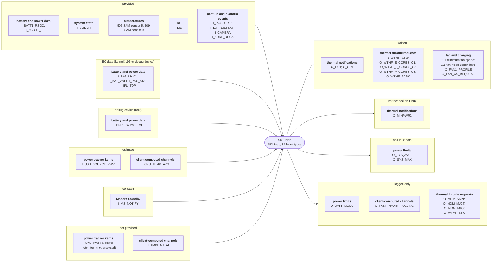

# Surface Pro 11 (Snapdragon, arm64)

Generated by `scripts/device-docs.py` from the local blob corpus, as of 16.11.2026. Status of the Linux side: [`../specs/inputs.md`](../specs/inputs.md), [`../specs/outputs.md`](../specs/outputs.md). Nothing on this page is verified on the device unless it says so.

## Blob

| File | Form | Lines | SHA-256 (text, first 16) | Engine runs it |
|---|---|---|---|---|
| Surface.SMF.117.0.0_117.0.0.94.bin | capsule/B | 126 | `fca9a4bb209c63ea` | ✓ |
| Surface.SMF.117.0.1_117.0.1.95.bin | capsule/B | 123 | `ceeba25463957666` | ✓ |
| Surface.SMF.117.0.2_117.0.2.97.bin | capsule/B | 117 | `c968faed08551974` | ✓ |
| Surface.SMF.117.0.3_117.0.3.94.bin | capsule/B | 117 | `c2ddaf70e8e7aa76` | ✓ |

- **Platform:** Qualcomm Snapdragon (arm64)
- **Controller variant:** `direct` (no profile: default)
- **Block types:** add_sub_scale (28), conditional_table (16), ewma (20), hysteresis_quantiser (12), hysteresis_table (10), linear_map (12), lookup_table (104), min_max (71), multiplexer (8), multiply_divide (20), pass_through (70), pid_sets (12), variable_pid (8), window_comparator (20)

## Overview

Every input and output of the blob(s), grouped by what Linux does with it.

## Readiness

A device can be controlled only when every output of its blob is written: a blob that regulates the CPU but whose fan, throttle or safety outputs go nowhere would run with part of its design missing.

| Check | Result |
|---|---|
| Blob runs | ✓ |
| Inputs with a Linux source | 18 of 21 (missing: `049E36F2/2`, `049E36F2/6`) (no source, but it reaches no output: `87008365/200`) |
| Outputs written by Linux | 11 of 20; not needed on Linux: `110DF2A4/3` (not written: `0B7B5350/54`, `0B7B5350/55`, `0B7B5350/70`, `87008365/220`, `9BBB8910/103`, `9BBB8910/104`, `9BBB8910/105`, `9BBB8910/200`) |
| Ready for control | no: dry-run only |

## Inputs

| Channel | Microsoft name | Meaning | Linux source | Status | Reaches limits |
|---|---|---|---|---|---|
| `049E36F2/2` | I_SYS_PWR | system power from the power meters, mW | – | not provided | – |
| `049E36F2/6` | – | power-meter item (not analysed) | – | not provided | – |
| `049E36F2/9` | I_USB_SOURCE_PWR | power out of the USB-C ports, mW | Type-C ports (upper bound) | estimate | psys PL2 |
| `28B7BD85/1` | I_BATT1_RSOC | charge level of battery 1, % | `BAT1/capacity` | provided | – |
| `28B7BD85/3` | I_BAT_MAX1 | battery sustained power, mW | EC `0x53` | EC data (kernel#195 or debug device) | – |
| `28B7BD85/5` | I_BAT_VNL1 | battery open-circuit voltage, mV | EC `0x53` | EC data (kernel#195 or debug device) | psys PL2 |
| `28B7BD85/7` | I_PSU_SIZE | power supply rating, mW | EC `ARTG` | EC data (kernel#195 or debug device) | – |
| `28B7BD85/8` | I_IPL_TOP | available input power, mW | EC `0x53` | EC data (kernel#195 or debug device) | psys PL2 |
| `28B7BD85/12` | I_BCDR1_I | battery current, mA (+ discharging) | `BAT1` current or power/voltage | provided | – |
| `28B7BD85/13` | I_BDR_EWMA1_LVL | discharge-rate EWMA level | EC `0x1A` | debug device (root) | – |
| `2DD6960F/1` | I_SLIDER | power slider 1–10 | `platform_profile` × AC | provided | psys PL2 |
| `2E8B14C2/505` | – | SAM sensor 5 | hwmon `surface_thermal` temp5 | provided | – |
| `2E8B14C2/509` | – | SAM sensor 9 | hwmon `surface_thermal` temp9 | provided | – |
| `5D0EE597/1` | I_LID | lid open/closed | lid switch | provided | – |
| `8060B17F/1` | I_POSTURE | posture 1–5 | `surface_dtx` + lid | provided | – |
| `8060B17F/2` | I_EXT_DISPLAY | external display connected | DRM connectors | provided | – |
| `8060B17F/3` | I_CAMERA | camera in use | video4linux runtime PM / open nodes | provided | – |
| `8060B17F/9` | I_SURF_DOCK | Surface Docks attached | USB IDs | provided | – |
| `87008365/112` | I_CPU_TEMP_AVG | averaged CPU temperature (client-computed) | `coretemp` package temperature, not averaged [H] (DV-7) | estimate | – |
| `87008365/200` | I_AMBIENT_AI | estimated ambient temperature (client-computed) | – | not provided | – |
| `DEF1AB69/100` | I_MS_NOTIFY | Modern Standby phase 1–5 | constant 4 | constant | – |

## Outputs

| Channel | Microsoft name | Meaning | Linux | Status | Range (default / max / min) |
|---|---|---|---|---|---|
| `0B7B5350/54` | O_SYS_AVG | psys PL1, platform long-term | none on Qualcomm Snapdragon (arm64) (Intel RAPL only) | no Linux path | 45000 / 250000 / 15000 |
| `0B7B5350/55` | O_SYS_MAX | psys PL2, platform short-term | none on Qualcomm Snapdragon (arm64) (Intel RAPL only) | no Linux path | 90000 / 250000 / 15000 |
| `0B7B5350/70` | O_BATT_MODE | battery mode (1 = no mains supply) | – | logged only | – |
| `110DF2A4/1` | O_HOT | hibernate request at 2 (thermal policy of zone `TPOL`) | thermal action: hibernate, else suspend | written | – |
| `110DF2A4/2` | O_CRT | critical shutdown request at 2 (thermal policy of zone `TPOL`) | thermal action: power off | written | – |
| `110DF2A4/3` | O_MINPWR2 | minimum-power flags (bit mask 0-7 of three controllers) | not needed on Linux: no Windows client takes it: the thermal-policy client registers channels 1 and 2 only, the power tracker only logs it [C] | not needed on Linux | – |
| `87008365/220` | O_FAST_MAXIM_POLLING | fast power-meter polling | – | logged only | – |
| `9BBB8910/5` | O_WTMF_GFX | throttle request for the GPU, % (100 = none) | GPU maximum frequency (i915, xe or devfreq; where the machine has one) | written | 100 / 100 / 0 |
| `9BBB8910/20` | O_WTMF_E_CORES_C1 | throttle request for a CPU cluster, % (100 = none) | cpufreq `scaling_max_freq` of the cluster | written | – |
| `9BBB8910/21` | O_WTMF_P_CORES_C2 | throttle request for a CPU cluster, % (100 = none) | cpufreq `scaling_max_freq` of the cluster | written | – |
| `9BBB8910/22` | O_WTMF_P_CORES_C3 | throttle request for a CPU cluster, % (100 = none) | cpufreq `scaling_max_freq` of the cluster | written | – |
| `9BBB8910/62` | O_WTMF_PARK | passive limit of zone `TPOL`, % (processor aggregator device) | cpufreq cap on all CPU policies (minimum with the other requests) | written | – |
| `9BBB8910/103` | O_MDM_SKIN | throttle request, % (100 = none) | – | logged only | 100 / 100 / 0 |
| `9BBB8910/104` | O_MDM_MJCT | throttle request, % (100 = none) | – | logged only | – |
| `9BBB8910/105` | O_MDM_MBJ0 | throttle request, % (100 = none) | – | logged only | – |
| `9BBB8910/200` | O_WTMF_NPU | throttle request, % (100 = none) | – | logged only | – |
| `B620798F/101` | – | minimum fan speed, rpm (fan 1) | SAM FAN `0x0b` through the SSAM debug device (root; neutral frame 0 at the restore) | written | – |
| `B620798F/111` | – | fan noise upper limit, SPL (fan 1) | SAM FAN `0x0c` through the SSAM debug device (root; neutral frame 0 at the restore) | written | – |
| `B620798F/201` | O_FAN1_PROFILE | fan profile, 1-4 (fan 1) | SAM FAN `0x0e`, sent by the kernel (`surface_platform_profile`, from the platform profile); the daemon does not send it | written | – |
| `B620798F/301` | O_FAN_CS_REQUEST | fan state, 1 normal / 2 standby | SAM FAN `0x0f`, sent by the kernel in its suspend hooks; the daemon never sends it | written | – |
