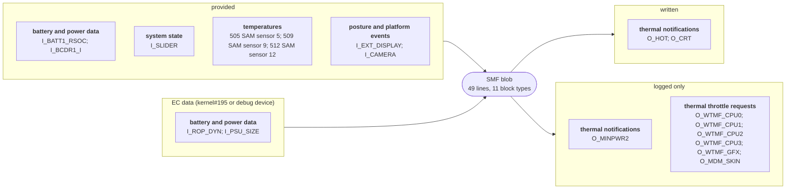

# Surface Pro 9 5G (arm64)

Generated by `scripts/device-docs.py` from the local blob corpus, as of 16.11.2026. Status of the Linux side: [`../specs/inputs.md`](../specs/inputs.md), [`../specs/outputs.md`](../specs/outputs.md). Nothing on this page is verified on the device unless it says so.

## Blob

| File | Form | Lines | SHA-256 (text, first 16) | Engine runs it |
|---|---|---|---|---|
| Smf_71.0.0.40.bin | capsule/B | 49 | `7f9975e4986181b5` | ✓ |

- **Platform:** Qualcomm Snapdragon (arm64)
- **Controller variant:** `direct` (no profile: default)
- **Block types:** add_sub_scale (1), conditional_table (1), hysteresis_quantiser (1), hysteresis_table (1), linear_map (1), lookup_table (7), min_max (4), multiplexer (2), pass_through (10), pid_sets (2), window_comparator (5)

## Overview

Every input and output of the blob(s), grouped by what Linux does with it.

## Readiness

A device can be controlled only when every output of its blob is written: a blob that regulates the CPU but whose fan, throttle or safety outputs go nowhere would run with part of its design missing.

| Check | Result |
|---|---|
| Blob runs | ✓ |
| Inputs with a Linux source | 10 of 10 |
| Outputs written by Linux | 2 of 9 (not written: `110DF2A4/3`, `9BBB8910/1`, `9BBB8910/2`, `9BBB8910/3`, `9BBB8910/4`, `9BBB8910/5`, `9BBB8910/103`) |
| Ready for control | no: dry-run only |

## Inputs

| Channel | Microsoft name | Meaning | Linux source | Status | Reaches limits |
|---|---|---|---|---|---|
| `28B7BD85/1` | I_BATT1_RSOC | charge level of battery 1, % | `BAT1/capacity` | provided | – |
| `28B7BD85/6` | I_ROP_DYN | rest-of-platform power, mW | EC `0x53` | EC data (kernel#195 or debug device) | – |
| `28B7BD85/7` | I_PSU_SIZE | power supply rating, mW | EC `ARTG` | EC data (kernel#195 or debug device) | – |
| `28B7BD85/12` | I_BCDR1_I | battery current, mA (+ discharging) | `BAT1` current or power/voltage | provided | – |
| `2DD6960F/1` | I_SLIDER | power slider 1–10 | `platform_profile` × AC | provided | – |
| `2E8B14C2/505` | – | SAM sensor 5 | hwmon `surface_thermal` temp5 | provided | – |
| `2E8B14C2/509` | – | SAM sensor 9 | hwmon `surface_thermal` temp9 | provided | – |
| `2E8B14C2/512` | – | SAM sensor 12 | hwmon `surface_thermal` temp12 | provided | – |
| `8060B17F/2` | I_EXT_DISPLAY | external display connected | DRM connectors | provided | – |
| `8060B17F/3` | I_CAMERA | camera in use | video4linux runtime PM / open nodes | provided | – |

## Outputs

| Channel | Microsoft name | Meaning | Linux | Status | Range (default / max / min) |
|---|---|---|---|---|---|
| `110DF2A4/1` | O_HOT | hibernate request at 2 (thermal policy of zone `TPOL`) | thermal action: hibernate, else suspend | written | – |
| `110DF2A4/2` | O_CRT | critical shutdown request at 2 (thermal policy of zone `TPOL`) | thermal action: power off | written | – |
| `110DF2A4/3` | O_MINPWR2 | minimum-power request | – | logged only | – |
| `9BBB8910/1` | O_WTMF_CPU0 | throttle request for a CPU cluster, % (100 = none) | candidate: cpufreq `scaling_max_freq` | logged only | 100 / 100 / 0 |
| `9BBB8910/2` | O_WTMF_CPU1 | throttle request for a CPU cluster, % (100 = none) | candidate: cpufreq `scaling_max_freq` | logged only | 100 / 100 / 0 |
| `9BBB8910/3` | O_WTMF_CPU2 | throttle request for a CPU cluster, % (100 = none) | candidate: cpufreq `scaling_max_freq` | logged only | 100 / 100 / 0 |
| `9BBB8910/4` | O_WTMF_CPU3 | throttle request for a CPU cluster, % (100 = none) | candidate: cpufreq `scaling_max_freq` | logged only | 100 / 100 / 0 |
| `9BBB8910/5` | O_WTMF_GFX | throttle request for the GPU, % (100 = none) | candidate: GPU maximum frequency | logged only | 100 / 100 / 0 |
| `9BBB8910/103` | O_MDM_SKIN | throttle request, % (100 = none) | – | logged only | 100 / 100 / 0 |
